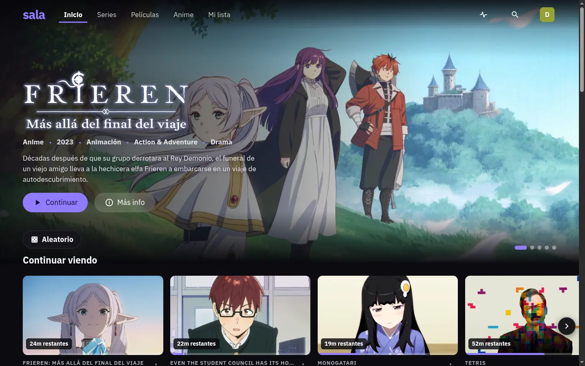
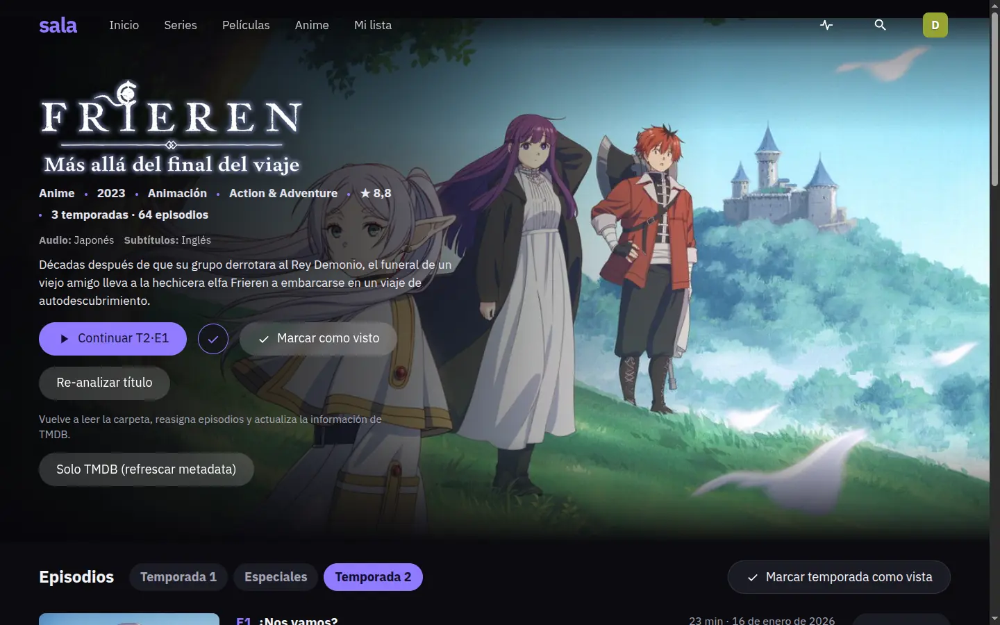
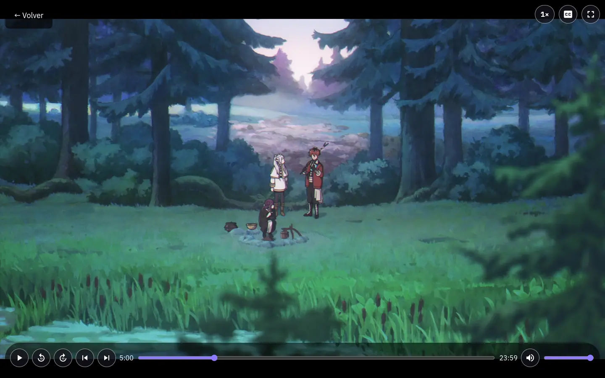
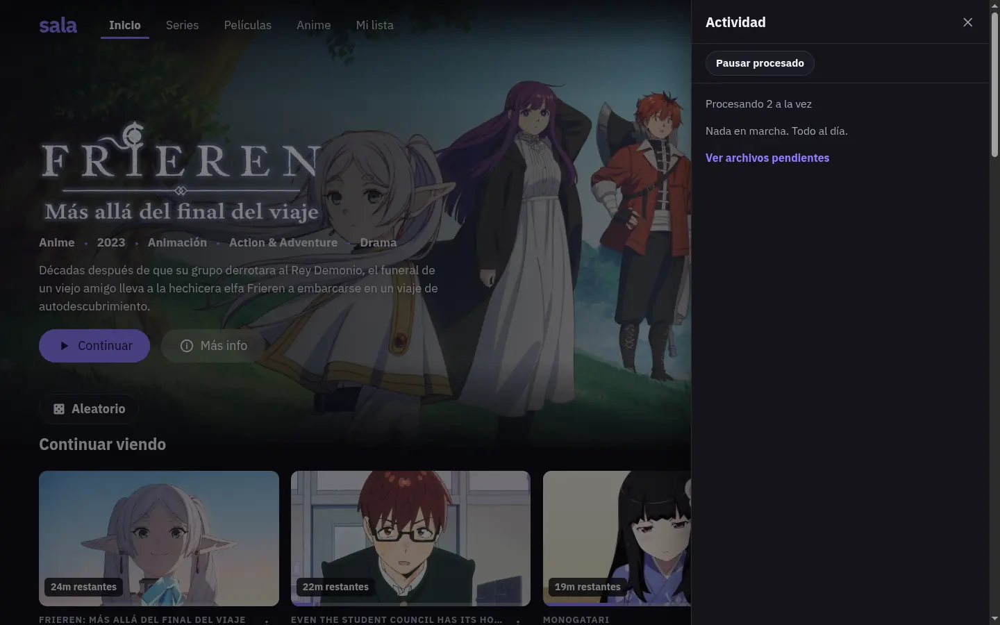
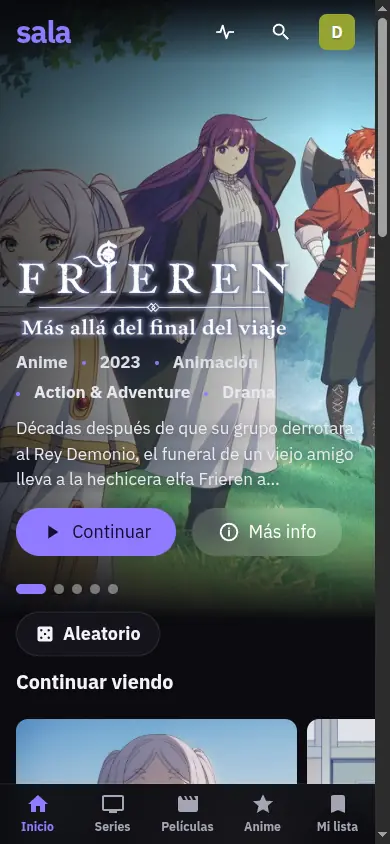
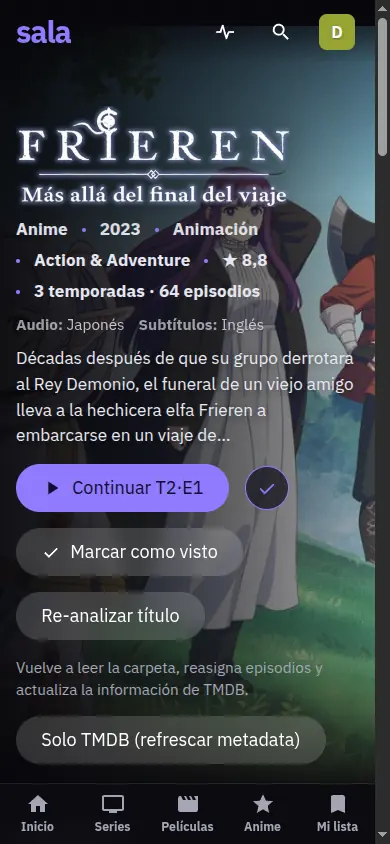
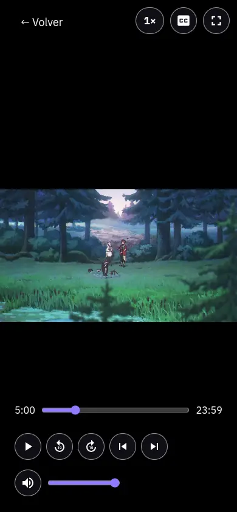

# Sala

**Español** · [English](README.en.md) · [Português](README.pt.md)

Plataforma local para ver tus películas, series y anime desde cualquier dispositivo conectado a tu WiFi (TV, celular, tablet o PC). Sin anuncios ni cuentas, con perfiles, Mi lista y Continuar viendo.

> **Arranque local:** `npm run dev` desde la raíz inicia backend (8080) y frontend (5174), con copia SQLite verificada y parada conjunta con `Ctrl+C`. Guía y aviso de copia/migración: [docs/local-development.md](docs/local-development.md). Si ya tienes biblioteca, lee ese aviso **antes de iniciar el backend**.
>
> Estado: funcional y en uso diario. Lo que falta, en el plan: [`odd/tasks/tv-series-library.md`](odd/tasks/tv-series-library.md).

## Capturas

**Escritorio**

| Inicio | Ficha de título |
| :---: | :---: |
|  |  |

| Reproductor | Actividad |
| :---: | :---: |
|  |  |

**Celular y TV**

| Inicio | Ficha de título | Reproductor |
| :---: | :---: | :---: |
|  |  |  |

Más capturas (Series, Películas, Anime, Mi lista, Búsqueda, Ajustes, Pendientes y perfiles) en [`docs/screenshots/`](docs/screenshots).

## Cómo agregar contenido

Coloca los videos dentro de la carpeta de contenido (`content/` por defecto, o la que elijas en la primera ejecución):

```
content/
├── films/      películas (un archivo o una carpeta por película)
└── shows/      series y anime (una carpeta por título)
    └── bakemonogatari/
        └── cualquier/subcarpeta/episodio_01.mkv
```

- **No hace falta renombrar.** La app busca en subcarpetas y deduce el título, la temporada y el episodio a partir de los nombres.
- **Si estás compartiendo un torrent (seeding), no renombres ni muevas los archivos**: el cliente torrent dejaría de encontrarlos.
- Descarga el torrent directamente en `content/shows/` o `content/films/`.
- Los archivos aún en descarga que se puedan identificar aparecen como **Próximamente**; los demás esperan hasta poder importarse.
- Openings, endings y comentarios se guardan como **extras**, no como episodios.
- Lo que la app no reconozca con seguridad aparece en **Pendientes** para que lo confirmes.

## Configuración

La app guarda la carpeta donde está tu contenido en su propia configuración (`~/.config/sala/config.json` en Linux, `%LOCALAPPDATA%\sala` en Windows); puedes cambiarla en Ajustes. No edites ese archivo a mano. El asistente de primera ejecución (o Ajustes) elige la carpeta; la sugerencia por defecto es `content/`.

1. Solo en una instalación nueva y **solo para desarrollo**, crea `.env` desde `.env.example` **sin sobrescribir uno existente**. `CONTENT_DIR` ahí es opcional: tu elección en la app tiene prioridad.
2. Configura tu *Read Access Token* de TMDB en `TMDB_READ_ACCESS_TOKEN`. Esta instalación ya lo tiene; no lo imprimas ni lo subas a git.

## Instalación

Todo se descarga desde **[Releases → última versión](https://github.com/daniel-morales-dev/tv-series-library/releases/latest)**, en la sección **Assets**.

### Windows 11 — siguiente, siguiente, listo

1. Descarga `sala-setup-<versión>.exe`.
2. Doble clic y **Siguiente → Siguiente → Instalar**.
3. Si Windows avisa *"Windows protegió su PC"*: **Más información → Ejecutar de todas formas**. El instalador no tiene firma digital de pago; no es un virus.
4. Deja marcada la casilla **Iniciar Sala y abrir el navegador** y pulsa **Finalizar**.

Ya está: se abre http://127.0.0.1:8080 y Sala vuelve a arrancar sola cada vez que inicies sesión. Viene todo incluido (Node, ffmpeg, servidor y web) y el instalador abre el puerto 8080 solo para tu red local.

Desinstalación y detalles: [packaging/windows/README.md](packaging/windows/README.md).

### macOS 12 o superior

**1. Averigua qué Mac tienes.** Menú Apple → **Acerca de esta Mac**:

- **Chip** dice `Apple M1`, `M2`, `M3`, `M4`… → descarga `sala-macos-arm64.dmg`.
- **Procesador** dice `Intel` → descarga `sala-macos-x64.dmg`.

**2. Instala.** Doble clic en el `.dmg` descargado y doble clic en **Instalar Sala**. Se abre una ventana de Terminal que copia la app a Aplicaciones y la abre sola.

**3. Si macOS la bloquea la primera vez.** Aparece un aviso de *"desarrollador no identificado"*: **clic derecho sobre `Instalar Sala` → Abrir → Abrir**. Si el aviso vuelve a salir, ve a **Ajustes del Sistema → Privacidad y seguridad**, baja hasta el mensaje sobre Sala y pulsa **Abrir de todas formas**. Solo hace falta esa vez: la app no está notarizada por Apple.

Listo: se abre http://127.0.0.1:8080 y Sala arranca sola al iniciar sesión. Tus datos quedan en `~/Library/Application Support/sala` y el registro en `~/Library/Logs/sala/server.log`.

> Si tu cuenta no es de administrador, la app se instala en `~/Applications` y **no** arranca sola al iniciar sesión. Puedes usarla igual.

Desinstalación y detalles: [packaging/macos/README.md](packaging/macos/README.md).

### Linux (Ubuntu y familia)

En Linux no hay instalador de doble clic: son seis pasos que se copian y pegan en la terminal (unos 5 minutos). Funciona en Ubuntu, Debian, Linux Mint y Pop!_OS.

**1. Abre la terminal.** Pulsa `Ctrl` + `Alt` + `T`.

**2. Mira si ya tienes Node 24.** Pega esto y pulsa Enter:

```sh
node --version
```

- Responde `v24.…` o superior → salta al **paso 4**.
- Responde un número menor, o `command not found` → sigue al paso 3.

**3. Instala Node 24 y ffmpeg.** Pega las dos líneas (te pedirá tu contraseña; al escribir no se ve nada, es normal):

```sh
curl -fsSL https://deb.nodesource.com/setup_24.x | sudo -E bash -
sudo apt-get install -y nodejs ffmpeg
```

Cierra la terminal, ábrela de nuevo y repite el paso 2 para confirmar que ya dice `v24.…`. Node 24 es obligatorio: el que trae Ubuntu por defecto es demasiado viejo.

**4. Descarga Sala:**

```sh
git clone https://github.com/daniel-morales-dev/tv-series-library.git
cd tv-series-library
```

Si dice `command not found: git`, instálalo con `sudo apt install -y git` y repite.

**5. Instala y activa el servicio** (el primer comando tarda un par de minutos):

```sh
npm ci
bash scripts/linux-install.sh
systemctl --user daemon-reload
systemctl --user enable --now sala
```

**6. Ábrela** en el navegador de la laptop: http://localhost:8080

El asistente de primer arranque te pide la carpeta donde tienes tus videos y, si quieres carátulas y sinopsis, un token gratuito de TMDB. Puedes dejarlo para después: sin token reproduce igual, solo sin pósters.

**Arrancar al encender, sin iniciar sesión** (único paso con `sudo`):

```sh
sudo loginctl enable-linger "$USER"
```

Para verla desde el celular y la TV, el firewall y los comandos del día a día: [Correrlo en Linux (laptop) y verlo desde celular y TV](#correrlo-en-linux-laptop-y-verlo-desde-celular-y-tv).

## Correrlo en Linux (laptop) y verlo desde celular y TV

Si todavía no la instalaste, empieza por [Linux (Ubuntu y familia)](#linux-ubuntu-y-familia). No hace falta internet, pero celular y TV deben estar en la **misma WiFi** que la laptop.

1. **Firewall, solo si ufw está activo.** Primero revisa el estado:
   ```sh
   sudo ufw status
   ```
   Si dice `inactive`, sáltate este paso. Si dice `active`, averigua tu subred LAN:
   ```sh
   ip -4 -o addr show scope global
   ```
   Con tu subred (por ejemplo `192.168.1.0/24`), abre el puerto solo para ella:
   ```sh
   sudo ufw allow from 192.168.1.0/24 to any port 8080 proto tcp comment 'sala'
   sudo ufw status numbered      # verificar que la regla quedó
   ```
   No abras a `any`: la app no tiene autenticación.

2. **Conectar celular y TV.** En la laptop abre http://localhost:8080, ve a **Ajustes** (menú del perfil) y en **Ver desde el celular o la TV** escanea el QR con el celular, o escribe la URL en la TV. Si aparecen varias URL (Ethernet y WiFi), usa la de la red WiFi.

3. **Reservar la IP de la laptop en el router** (una vez): busca la reserva DHCP o IP fija por MAC y asigna la IP que muestra Ajustes. Así la URL y el QR no cambian.

4. **Operación:**
   - Estado: `systemctl --user status sala`
   - Logs: `journalctl --user -u sala -f`
   - Parar: `systemctl --user stop sala`
   - Reiniciar: `systemctl --user restart sala`
   - Actualizar: `git pull`, luego `npm ci`, `bash scripts/linux-install.sh` y `systemctl --user restart sala`

> **Aviso:** el servicio `sala` y `npm run dev` comparten el puerto 8080.
> - Con el servicio activo, `npm run dev` se niega a correr. Antes de desarrollar: `systemctl --user stop sala`.
> - Al detener el servicio, la app deja de responder (celular y TV) hasta que ejecutes `systemctl --user start sala`.
> - Detener `npm run dev` **no** arranca el servicio: hazlo tú con `systemctl --user start sala`.
> - Para saber si está corriendo: `systemctl --user status sala` (`inactive (dead)` = detenido).

### Usar sala

Al instalar con `scripts/linux-install.sh` queda el comando `sala` (en `~/.local/bin`; si tu terminal no lo encuentra, abre una nueva o añade esa carpeta al PATH). Con él no necesitas `systemctl`:

- `sala status`: dice si está en marcha y si hay videos procesándose, en cola o con error.
- `sala start` / `sala stop` / `sala restart`: iniciar, detener y reiniciar.
- `sala pause` / `sala resume`: pausar y reanudar el procesado de videos.
- `sala url`: la dirección para el celular y la TV. `sala open`: abre la biblioteca en este equipo.
- `sala logs`: el registro en vivo (Ctrl+C para salir). `sala --help`: la ayuda.
- `sala migrate-state [--dry-run] [--yes]`: copia la base de datos, imágenes y copias de recuperación de `data/` a `~/.local/share/sala/` (T47a). Verifica la copia, **no borra el origen** (te dice cómo hacerlo) y se niega si Sala está activa o el destino no está vacío. Mientras no la ejecutes, todo sigue usando `data/` como siempre. El video (HLS) no se mueve todavía.

Si `npm run dev` está usando el puerto 8080, `sala start` te lo avisa en vez de fallar sin explicar. `npm run dev` y `npm start` siguen funcionando igual.

### Desarrollo vs producción

- `npm run dev`: **solo desarrollo**. Backend con `--watch` (8080) + Vite (5174); la interfaz está en http://localhost:5174.
- `npm start`: **producción**. Construye `apps/web/dist` si falta o está viejo respecto al código web y corre solo el servidor (sin watch ni Vite) en http://localhost:8080, con las mismas guardias de puerto, carpeta de datos y copia SQLite que `dev`. El servicio `sala` ejecuta el mismo servidor y la misma carpeta `apps/web/dist` (la web la construye `scripts/linux-install.sh`).

## Documentación

- [Glosario](CONTEXT.md)
- [Decisiones de arquitectura](docs/adr/)

## Licencia

[MIT](LICENSE). Puedes usar, copiar, modificar y distribuir Sala, incluso con fines comerciales, siempre que conserves el aviso de copyright.
